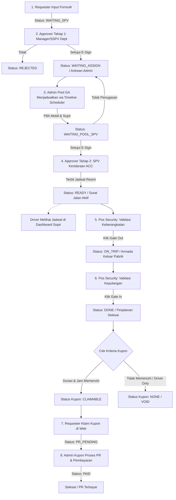

# BUKU PANDUAN PENGGUNAAN SISTEM (MANUAL BOOK)
## SISTEM MANAJEMEN OPERASIONAL ARMADA & DRIVER (JAI-FLEET)
**PT JAI (YAZAKI GROUP)**

---

## DAFTAR ISI
1. [Pendahuluan & Gambaran Umum Sistem](#1-pendahuluan--gambaran-umum-sistem)
2. [Matriks Peran Pengguna (User Roles & Access Control)](#2-matriks-peran-pengguna-user-roles--access-control)
3. [Alur Operasional End-to-End (Workflow Diagram)](#3-alur-operasional-end-to-end-workflow-diagram)
4. [Panduan Penggunaan Berdasarkan Peran & Modul](#4-panduan-penggunaan-berdasarkan-peran--modul)
   - [4.1 Requester (Pemohon Kendaraan)](#41-requester-pemohon-kendaraan)
   - [4.2 Approver Tahap 1 (SPV / Manager Departemen Pemohon)](#42-approver-tahap-1-spv--manager-departemen-pemohon)
   - [4.3 Admin Utama Pool GA (Scheduling & Resource Manager)](#43-admin-utama-pool-ga-scheduling--resource-manager)
   - [4.4 Approver Tahap 2 (SPV Kendaraan / Pool GA)](#44-approver-tahap-2-spv-kendaraan--pool-ga)
   - [4.5 Driver (Sopir Operasional)](#45-driver-sopir-operasional)
   - [4.6 Security (Pos Keamanan Gerbang Keluar/Masuk)](#46-security-pos-keamanan-gerbang-keluarmasuk)
   - [4.7 Admin Kupon (Finance / Reimbursement Klaim Makan Lembur)](#47-admin-kupon-finance--reimbursement-klaim-makan-lembur)
5. [Fitur Unggulan Sistem (Key Technical Highlights)](#5-fitur-unggulan-sistem-key-technical-highlights)
6. [Tanya Jawab & Penanganan Masalah (FAQ & Troubleshooting)](#6-tanya-jawab--penanganan-masalah-faq--troubleshooting)

---

## 1. PENDAHULUAN & GAMBARAN UMUM SISTEM

**JAI-Fleet** adalah aplikasi berbasis web yang dirancang khusus untuk memodernisasi dan mendigitalkan seluruh siklus pengelolaan armada kendaraan operasional dan supir di lingkungan PT JAI (Yazaki Group).

### Tujuan Utama:
1. **Menghilangkan Formulir Kertas (Paperless)**: Pengajuan perjalanan dinas, persetujuan atasan (E-Sign), hingga pos gerbang security beralih ke sistem digital realtime.
2. **Optimalisasi Utilitas Armada**: Mencegah tabrakan jadwal (*double booking*) kendaraan dan supir melalui kalender timeline interaktif.
3. **Transparansi & Akuntabilitas**: Melacak status posisi armada dari mulai permohonan diajukan, verifikasi SPV, approval kendaraan, pencatatan waktu keluar (*Gate Out*) hingga kembali (*Gate In*).
4. **Otomatisasi Klaim Kupon**: Menghitung secara otomatis hak kupon makan/lembur driver dan penumpang sesuai durasi perjalanan dan jam operasional.

---

## 2. MATRIKS PERAN PENGGUNA (USER ROLES & ACCESS CONTROL)

Sistem menyediakan 8 level otorisasi akses sesuai struktur organisasi matriks PT JAI:

| No | Peran (Role) | Pengguna Utama | Tanggung Jawab & Ruang Lingkup |
|:---:|:---|:---|:---|
| 1 | **Requester** | Admin PIC Departemen / Expat User | Mengisi form permohonan kendaraan, memilih rute multi-tujuan, mendaftarkan penumpang, serta memantau status persetujuan. |
| 2 | **Approver (Tahap 1)** | Manager & SSPV Departemen Pemohon | Memeriksa urgensi permohonan dinas anggota departemennya dan memberikan E-Sign persetujuan atau penolakan. |
| 3 | **Admin (Pool GA)** | Staff Pengelola Pool Kendaraan GA | Mengelola ketersediaan armada & driver, menjadwalkan permohonan via drag-and-drop timeline, master data kendaraan, supir, serta kelola data akun sistem. |
| 4 | **Admin Lobby (Frontdesk)** | Staff Receptionist / Admin Lobby Frontdesk | Seluruh fitur sama persis dengan Admin Pool Utama (penjadwalan timeline, master kendaraan, master driver, live data, beban kerja), **kecuali akses menu Kelola Data Akun** yang dibatasi khusus untuk Admin Utama. |
| 5 | **Approver Pool (Tahap 2)** | SPV Kendaraan (Hayu Prasetyo Utomo) | Memeriksa kelayakan penugasan kendaraan & supir yang telah dijadwalkan oleh Admin GA sebelum armada diberangkatkan. |
| 6 | **Driver** | Supir Operasional (8 Driver PT JAI) | Memeriksa jadwal tugas harian, daftar penumpang, rute tujuan, serta status izin jalan yang sudah terbit (*READY*). |
| 7 | **Security** | Petugas Pos Keamanan Gerbang PT JAI | Mencatat dan memvalidasi waktu keberangkatan (*Gate Out*) dan waktu kedatangan kembali (*Gate In*) secara realtime dengan 1 klik. |
| 8 | **Admin Kupon** | Bagian Kupon / Keuangan | Memproses verifikasi klaim kupon dinas yang memenuhi syarat, pembuatan nomor PR (*Purchase Requisition*), hingga pencairan pembayaran (*PAID*). |

---

## 3. ALUR OPERASIONAL END-TO-END (WORKFLOW DIAGRAM)

---

## 4. PANDUAN PENGGUNAAN BERDASARKAN PERAN & MODUL

### 4.1 REQUESTER (PEMOHON KENDARAAN)
Akun Requester dipegang oleh para Admin Bagian/Departemen (seperti PGA, FATP-EXIM, QA, Produksi, PPIC, PP-NYS, ME) dan Expat.

#### Menu Navigasi:
1. **Dashboard**: Menampilkan kalender ketersediaan seluruh armada (view harian, mingguan, bulanan) agar pemohon mengetahui kendaraan mana yang sedang kosong sebelum mengajukan.
2. **Ajukan Kendaraan (Form Pemesanan)**:
   - **Kategori**: Pilih `Dinas` (keperluan kantor/bisnis) atau `Non-Dinas`.
   - **Tanggal & Jam**: Masukkan tanggal keberangkatan, estimasi jam berangkat (*Est Departure*), dan estimasi jam kembali (*Est Return*).
   - **Tamu / User**: Nama personil utama yang menggunakan kendaraan (bisa pimpinan, auditor, atau teknisi).
   - **Tujuan (Autocomplete & Multi-Drop)**: Ketik nama tujuan untuk memilih dari master lokasi (misal: Bandara Juanda, Kantor Pajak, Pelabuhan Tanjung Perak) atau tambahkan tujuan multi-drop (+ Tambah Tujuan).
   - **Daftar Penumpang**: Masukkan nama penumpang, NIK, dan departemen (bisa menambahkan beberapa orang sekaligus).
   - **Opsi "Hanya Driver"**: Centang jika perjalanan hanya untuk kurir barang/dokumen tanpa ada orang yang menumpang.
   - **Pilihan Approver**: Pilih nama Manager / SSPV departemen pemohon yang berwenang memberikan persetujuan tahap 1.
3. **Notifikasi & Riwayat (Inbox)**:
   - Memantau status perjalanan: `Menunggu SPV`, `Menunggu Admin`, `Menunggu SPV Kendaraan`, `Siap Berangkat (READY)`, hingga `Selesai (DONE)`.
   - Tombol **Cetak Surat Jalan (E-Pass)** tersedia saat status sudah `READY`.
4. **Panel Kupon**:
   - Jika perjalanan dinas memenuhi batas minimal durasi makan siang / malam, perjalanan yang selesai (*DONE*) akan berstatus `CLAIMABLE`.
   - Pemohon cukup menekan tombol **"Klaim Kupon"** agar pengajuan diteruskan ke Admin Kupon.

---

### 4.2 APPROVER TAHAP 1 (SPV / MANAGER DEPARTEMEN PEMOHON)
Diperuntukkan bagi Manager dan Senior Supervisor masing-masing departemen.

#### Menu Navigasi:
1. **Inbox Persetujuan (E-Sign)**:
   - Menampilkan daftar permohonan kendaraan yang diajukan oleh staf di departemennya.
   - Terdapat ringkasan: Pemohon, Tamu, Tujuan, Jam, dan Keperluan.
   - **Tindakan Persetujuan**:
     - Klik **"Setujui (Approve)"**: Membubuhkan persetujuan elektronik. Status permohonan otomatis berpindah ke `WAITING_ASSIGN` (masuk ke antrean Admin Pool GA).
     - Klik **"Tolak (Reject)"**: Memasukkan alasan penolakan (misal: "Keperluan rapat ditunda"). Permohonan akan berhenti dan pemohon menerima notifikasi.
2. **Dashboard Armada**: Akses pemantauan armada menyeluruh untuk melihat pergerakan mobil perusahaan.

---

### 4.3 ADMIN UTAMA POOL GA (SCHEDULING & RESOURCE MANAGER)
Peran sentral yang bertugas mengelola fisik armada, supir, dan plotting jadwal.

#### Menu Navigasi:
1. **Dashboard**: Ringkasan statistik operasional, trip aktif, mobil standby, dan utilisasi harian.
2. **Waiting List & Jadwal (Scheduling Center)**:
   - **Kolom Kiri (Antrean Pengajuan)**: Menampilkan seluruh request dari semua departemen yang telah di-ACC oleh Manager/SSPV.
   - **Kolom Kanan (Interactive Timeline Scheduler)**: 
     - Tampilan grid matriks seluruh kendaraan (Innova Zenix, Innova Reborn, Avanza) terhadap slot jam 06:00 s.d 22:00.
     - **Cara Menjadwalkan**:
       1. Klik salah satu kartu permohonan di kolom antrean kiri.
       2. Arahkan mouse ke baris kendaraan yang diinginkan pada kalender timeline.
       3. **Klik & drag** pada slot jam kosong sesuai durasi perjalanan.
       4. Muncul jendela konfirmasi penugasan: Pilih **Nama Supir** yang bertugas dan tambahkan Catatan Admin (opsional).
       5. Klik **"Simpan & Ajukan ke SPV Kendaraan"**. Status menjadi `WAITING_POOL_SPV`.
   - **Opsi Mobil Lain / Mobil Manajer**: Jika armada utama penuh, admin dapat memilih opsi "Mobil Lain" dengan memblokir mobil default supir agar supir tidak terjadwal ganda.
3. **Kelola Data (Master Data Management)**:
   - **Daftar Kendaraan**: Menambah armada baru, mengatur kapasitas, kategori (*Mobil Operasional*, *Mobil Expat*, *Mobil Sewa*), serta mengubah status aktif/maintenance.
   - **Daftar Sopir**: Manajemen data 8 supir PT JAI, no telepon, jenis SIM, plat default, serta toggle status cuti (*On Leave*).
   - **Data Akun**: Menambah atau mengedit username, nama lengkap, NIK, peran, dan reset password seluruh akun pengguna. Dilengkapi verifikasi otentikasi password admin untuk melihat password akun.
4. **Live Data**: Tabel tabular menyeluruh seluruh riwayat perjalanan dengan filter tanggal, pencarian, dan opsi export.
5. **Beban Kerja**: Grafik analitik pembagian jam terbang dan ritase kerja masing-masing driver untuk pemerataan tugas.
6. **Panduan / Guidance (Dropdown Khusus Admin Utama)**:
   - **Panduan / Guidance**: Menampilkan slide presentasi interaktif berjalan otomatis (auto-play dengan pause, timer durasi, dan indikator progres).
   - **Kelola Panduan**: Mengatur materi slide PPT per akun/peran, menambah slide baru, mengedit teks/checklist, mengatur durasi perpindahan slide (detik), hingga opsi embed tautan PPT eksternal (Google Slides/Canva/OneDrive).

---

### 4.4 ADMIN LOBBY (FRONTDESK OPERATIONAL)
Diperuntukkan bagi staf resepsionis atau admin meja depan (*frontdesk lobby*) untuk operasional harian armada.

#### Fitur & Hak Akses:
1. **Fitur Sama Persis dengan Admin Utama**:
   - Dapat mengakses **Dashboard Realtime**, grafik utilisasi armada, dan kanban status sopir.
   - Dapat melakukan penjadwalan & plotting armada via **Waiting List & Jadwal (Scheduling Center)**.
   - Dapat mengelola data armada pada **Daftar Kendaraan** dan data personil pada **Daftar Sopir**.
   - Dapat memonitor **Live Data** dan analitik **Beban Kerja**.
2. **Batasan Akses**:
   - **Tidak memiliki akses ke menu Kelola Data Akun**: Menu sub-kategori "Data Akun" disembunyikan dari navbar dan diproteksi otomatis jika diakses secara paksa demi menjaga keamanan privasi akun & kredensial password karyawan PT JAI.

---

### 4.5 APPROVER TAHAP 2 (SPV KENDARAAN / POOL GA)
Diperuntukkan bagi Penanggung Jawab Kendaraan (Hayu Prasetyo Utomo).

#### Menu Navigasi:
1. **Inbox Approval SPV Kendaraan**:
   - Memeriksa jadwal kendaraan dan supir yang telah dipetakan oleh Admin GA.
   - Memastikan tidak terjadi kelebihan jam kerja supir atau bentrok pemakaian unit kendaraan.
   - Klik **"Setujui (Approve)"**: Status trip resmi berubah menjadi `READY`. E-Pass izin jalan resmi diterbitkan, supir dapat melihat tugasnya, dan pos gerbang security siap melakukan check-out.
   - Klik **"Tolak"**: Mengembalikan jadwal ke antrean Admin GA dengan catatan revisi.

---

### 4.5 DRIVER (SOPIR OPERASIONAL)
Tampilan ramah smartphone (*mobile-friendly*) bagi 8 sopir resmi PT JAI.

#### Menu Navigasi:
1. **Jadwal Tugas Driver**:
   - Menampilkan daftar perjalanan hari ini dan jadwal mendatang yang menugaskan dirinya.
   - Memuat detail lengkap: Nomor Polisi Kendaraan yang dibawa, Jam Keberangkatan, Nama Tamu/PIC, Departemen, Rute Tujuan, dan Catatan Khusus dari Admin GA.
   - Memberikan visibilitas instan tanpa perlu supir menanyakan jadwal secara manual ke kantor GA.

---

### 4.6 SECURITY (POS KEAMANAN GERBANG)
Digunakan oleh petugas keamanan di gerbang pos keluar masuk pabrik PT JAI.

#### Menu Navigasi:
1. **Gate Clearance (Pos Gerbang)**:
   - **Tab Gerbang Keluar (Gate Out)**:
     - Menampilkan daftar perjalanan berstatus `READY` untuk hari ini.
     - Saat mobil hendak keluar gerbang, security mencocokkan plat mobil dan nama supir, lalu menekan tombol **"Keluar Gerbang (Gate Out)"**.
     - Sistem otomatis merekam stempel waktu presisi keberangkatan (`timeGo`) dan mengubah status menjadi `ON_TRIP`.
   - **Tab Gerbang Kembali (Gate In)**:
     - Menampilkan armada yang saat ini sedang berada di luar pabrik (`ON_TRIP`).
     - Saat mobil kembali masuk ke area pabrik, security menekan tombol **"Masuk Gerbang (Gate In)"**.
     - Sistem merekam waktu kembali (`timeBack`), menghitung durasi aktual dinas dalam satuan menit, dan mengubah status menjadi `DONE`.

---

### 4.7 ADMIN KUPON (FINANCE & REIMBURSEMENT)
Dikelola oleh bagian kupon/keuangan untuk verifikasi hak makan dinas.

#### Menu Navigasi:
1. **Pending Claims (Klaim Tertunda)**:
   - Menampilkan daftar perjalanan `DONE` yang kuponnya telah diajukan oleh Requester (`PR_PENDING`).
   - Admin kupon memverifikasi jam keberangkatan dan kepulangan apakah sesuai dengan kebijakan uang saku/makan dinas.
   - Klik **"Proses PR"** untuk memasukkan ke antrean proses pembuatan Purchase Requisition di finance (`PR_PROGRESS`).
2. **Riwayat & Pembayaran**:
   - Menyelesaikan pencairan kupon dengan memasukkan **Nomor PR** dan nama admin pembayar.
   - Status kupon menjadi `PAID`, tercatat rapi di audit trail keuangan.

---

## 5. FITUR UNGGULAN SISTEM (KEY TECHNICAL HIGHLIGHTS)

1. **Sinkronisasi Otomatis Cloud (Supabase PostgreSQL)**:
   - Seluruh data akun, kendaraan, supir, perjalanan, dan kupon tersimpan di database PostgreSQL cloud Supabase secara realtime.
2. **Interactive Drag-and-Drop Scheduler**:
   - Memetakan jadwal armada semudah menarik kursor pada slot jam kalender, otomatis menghitung durasi dan memvalidasi tumpang tindih waktu.
3. **Pencetakan Surat Jalan Digital (E-Pass Printable)**:
   - Format surat jalan resmi berstandar PT JAI (Yazaki Group) yang siap dicetak atau disimpan sebagai PDF.
4. **Manajemen Proteksi Password Admin**:
   - Kredensial akun di menu kelola data dilindungi lapisan keamanan modal otentikasi password admin sebelum dapat melihat kata sandi pengguna.
5. **Multi-Drop & Multi-Passenger Routing**:
   - Mendukung penambahan banyak titik singgah destinasi dan rombongan penumpang antar-departemen dalam satu permohonan kendaraan.

---

## 6. TANYA JAWAB & PENANGANAN MASALAH (FAQ & TROUBLESHOOTING)

#### Q1: Mengapa pengajuan kendaraan saya belum bisa dicetak Surat Jalannya?
> **Jawaban**: Surat Jalan (E-Pass) baru dapat diterbitkan setelah permohonan melalui **2 tahap persetujuan**: (1) Di-ACC oleh Manager/SSPV Departemen Anda, dan (2) Di-ACC oleh SPV Kendaraan (Pool GA). Pastikan status permohonan Anda di menu Notifikasi sudah bertanda hijau `READY`.

#### Q2: Apa yang harus dilakukan jika ada kebutuhan mobil dinas mendesak (*urgent*)?
> **Jawaban**: Pemohon segera membuat pengajuan di web, kemudian mengabari Manager/SSPV untuk membuka web dan melakukan E-Sign. Setelah itu, Admin Pool GA dapat langsung memplot kendaraan prioritas pada Interactive Scheduler.

#### Q3: Bagaimana jika supir membawa mobil yang bukan mobil default-nya?
> **Jawaban**: Admin GA dapat memanfaatkan fitur **"Mobil Lain"**. Sistem akan otomatis memblokir baris kendaraan default supir tersebut agar tidak dijadwalkan secara bersamaan oleh staf lain.

#### Q4: Kapan sebuah perjalanan berhak mendapatkan kupon makan?
> **Jawaban**: Kupon makan/lembur diberikan otomatis oleh sistem (`CLAIMABLE`) untuk perjalanan dinas yang durasinya melebihi batas jam makan (siang/malam) sesuai regulasi HR PT JAI. Perjalanan bertipe *"Hanya Driver"* (antar barang/dokumen tanpa penumpang) otomatis berstatus `VOID` (hangus).
